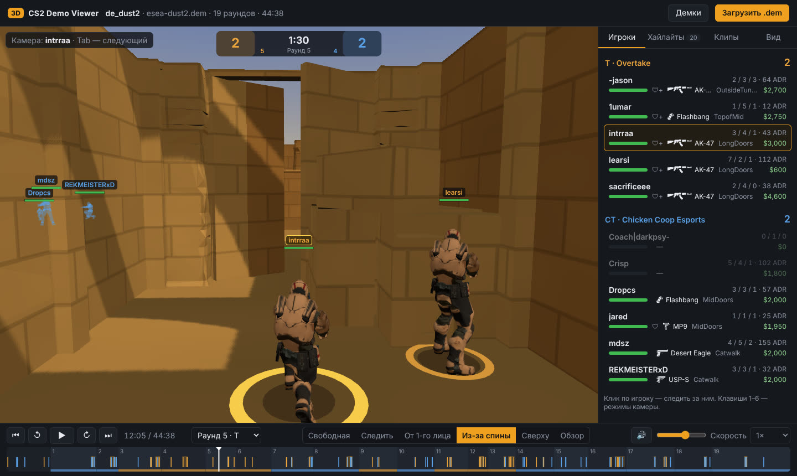
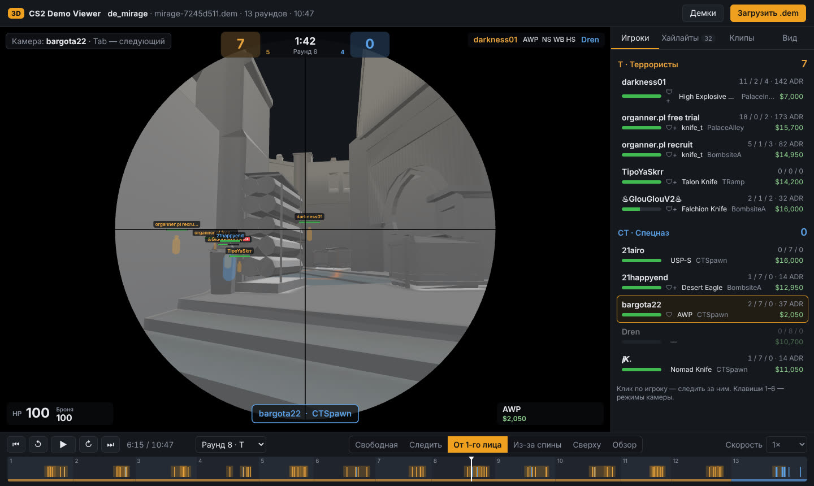
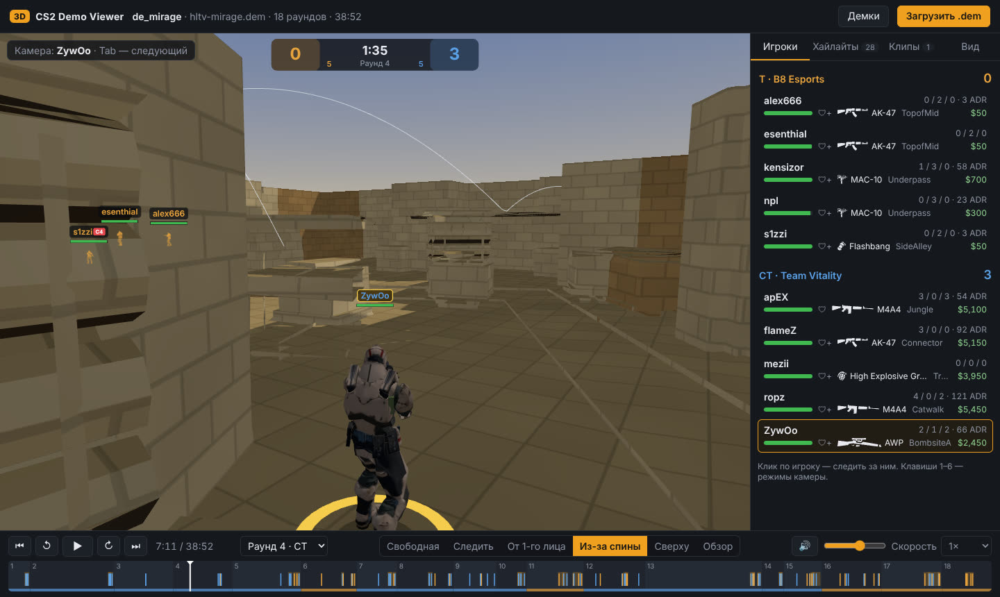

# CS2 3D Demo Viewer

3D-просмотр демок Counter-Strike 2 в браузере, собственный парсер демо и
**автоматическая запись клипов** лучших моментов (мультикиллы, клатчи, ноускопы…)
в MP4.

- **Парсер** `.dem` (на базе [demoparser2](https://github.com/LaihoE/demoparser)): позиции и углы
  обзора всех игроков, HP/броня/оружие/деньги, раунды, киллы, выстрелы, урон,
  траектории гранат, дымы, молотовы, бомба, статистика. Демо на 13 раундов
  разбирается за ~4 секунды.
- **3D-просмотрщик** на Three.js: настоящая геометрия карты (коллизионный меш из
  файлов игры), **раскрашенная под каждую карту** (штукатурка, кирпич, каменные
  блоки, бетон, плитка, черепица), с тенями от солнца и небом; **анимированные
  модели игроков** (бег, ходьба, присед, наклон за взглядом, оружие в руках, тела
  убитых), трассеры, гранаты, **объёмные дымы** (не просачиваются сквозь стены,
  простреливаются — пули оставляют в дыму дыры, HE-граната разбивает дым на пару
  секунд), **следы от пуль** на стенах, молотовы, бомба, килфид **с иконками оружия**
  (хедшот, прострел, через дым, ноускоп, вслепую, в прыжке), табло с таймером,
  HUD от первого лица с оружием в руках, скоупом и ослеплением от флешек.
- **Звук**: выстрелы (свой у каждого класса оружия, глушители), гранаты, дымы,
  горящий молотов, бомба (писк ускоряется), шаги, попадания и «динь» за килл —
  с позиционированием в пространстве. Звук пишется и в клипы (всегда AAC, чтобы
  играл на телефонах и в мессенджерах).
- **Войс игроков** из демо (FACEIT, ESEA, свои демки): все / команда игрока /
  только он / T / CT, значок микрофона у говорящих; войс пишется и в клипы.
- **Демки FACEIT по ссылке на матч**: вставьте ссылку — демо скачается,
  распакуется и откроется (нужен ключ FACEIT API, см. [«Демки FACEIT»](#демки-faceit));
  скачанные вручную `.dem.zst` открываются как есть.
- **POV игрока**: вид от первого лица по целым раундам — пока игрок жив, обычная
  скорость, после смерти остаток раунда **ускоряется** (×4/×8/×16) с видом от
  живого тиммейта, закупка пропускается. Можно смотреть (кнопка ⏩) и **записать
  в один MP4** вместе с войсом игрока и его команды.
- **6 камер**: свободная, «следить», от первого лица, из-за спины, сверху (как
  радар), обзор под углом. Срез крыш, игроки сквозь стены, таймлайн с раундами и
  киллами, перемотка, скорость 0.25×–16×.
- **Поиск хайлайтов**: 2K/3K/4K/ACE, выигранные клатчи 1vX, ноускопы, прострелы,
  киллы через дым, в прыжке, вслепую, ножом и зевсом — с оценкой «зрелищности».
- **Автозапись клипов**:
  - в браузере одной кнопкой — покадрово через WebCodecs, сразу в H.264 MP4
    (быстрее реального времени на видеокарте);
  - на сервере (headless Chromium) — из интерфейса или командой `cs2demo render`;
  - **полностью автоматически**: `cs2demo watch` следит за папкой с демками и
    записывает лучшие моменты каждого нового матча; в веб-интерфейсе есть галочка
    «Автозапись 5 лучших после загрузки демо».
  - камера клипа: от первого лица / из-за спины / сверху; 720p, 1080p, 1440p или
    вертикальное 1080×1920 (Shorts/TikTok); 30/60 FPS; замедление на киллах;
    титры, килфид и HUD; звук.

Всё работает локально: демо никуда не отправляется.

## Веб-версия: без установки, в том числе с телефона

**https://knyazvaleriy1-ai.github.io/3DDEMOPARSERCS2/** (GitHub Pages) или свой
адрес на Vercel — как опубликовать, см. [«Публикация сайта»](#публикация-сайта).

Откройте ссылку, нажмите «Открыть демо» и выберите `.dem`, архив `.rar` с HLTV или
`.dem.zst` с FACEIT (или вставьте ссылку на матч FACEIT). Ничего не
загружается на сервер: демо разбирает прямо в браузере тот же парсер
(demoparser2, скомпилированный в WebAssembly), а логика сборки данных — точная
копия Python-парсера (вывод совпадает байт в байт). Разобранные демо и записанные
клипы хранятся в браузере (IndexedDB), их можно открыть снова без повторного
разбора. Клипы пишутся в MP4 прямо в браузере: «Скачать» или «Поделиться» (на
телефоне — сразу в Telegram, галерею и т. п.).

- Демо на ~80 МБ разбирается за ~10 секунд, на 350–550 МБ (про-матчи с HLTV) —
  за 40–80 секунд на компьютере и дольше на телефоне. Браузеру нужно примерно
  в 2–3 раза больше памяти, чем весит файл: очень большие демо на слабых
  телефонах могут не открыться.
- Архив `.rar` с HLTV открывается как есть: сайт сам распакует его прямо в
  браузере и спросит, какие карты разобрать (уже разобранные откроются сразу).
  Архив читается по кускам, а распакованное сразу уходит в парсер, поэтому
  памяти нужно столько же, сколько для обычной `.dem`. Архивы с паролем и
  многотомные (`.part1.rar`…) не поддерживаются.
- Чего нет в веб-версии: рендера на сервере, папки-наблюдателя и склейки нарезки —
  для этого нужна обычная (Python) версия. Скачивание с FACEIT по ссылке работает
  в версии на Vercel (функция `api/faceit.js`), на GitHub Pages — только открытие
  скачанного файла.

### Публикация сайта

Сайт — статические файлы; собрать его вручную: `python scripts/build_site.py site/`
и раздать папку `site/` любым статическим сервером (в корне домена или в
подпапке — все пути относительные). Готовые варианты:

**Vercel.** [](https://vercel.com/new/clone?repository-url=https%3A%2F%2Fgithub.com%2Fknyazvaleriy1-ai%2F3DDEMOPARSERCS2)
— или на vercel.com: **Add New → Project → Import** этот репозиторий →
**Deploy**, ничего не меняя: настройки берутся из `vercel.json` (сборка
`scripts/vercel_build.sh` → папка `dist/`, кэширование ассетов). При сборке
Vercel скачивает карты из awpy-data и модель игрока (~1 минута). Дальше каждый
пуш в `master` публикуется автоматически, а для каждого pull request Vercel
делает отдельную preview-ссылку.

Чтобы на сайте работали ссылки на матчи FACEIT, добавьте ключ: **Settings →
Environment Variables → `FACEIT_API_KEY`** (и `FACEIT_DOWNLOADS_TOKEN`, если FACEIT
выдал отдельный токен), затем **Redeploy**. Подробнее — [«Демки FACEIT»](#демки-faceit).

Если сборка падает с «No entrypoint found» (или «No FastAPI entrypoint
found»), значит, в собираемой ветке нет `vercel.json`: без него Vercel
принимает репозиторий за сервер на Node.js/FastAPI и ищет `app.js`/`main.py`.
`vercel.json` перекрывает пресет, выбранный в настройках проекта, так что
менять там ничего не нужно — только собирать ветку, где он есть.

**GitHub Pages.** Собирается при каждом пуше в `master` (GitHub Actions, см.
`.github/workflows/pages.yml`). Один раз нужно включить Pages: **Settings →
Pages → Build and deployment → Source: GitHub Actions**, затем перезапустить
последний запуск «Web version (GitHub Pages)» во вкладке **Actions** (или
просто сделать следующий пуш).

WebAssembly-парсер лежит в `cs2demo/web/vendor/demoparser/`;
пересобрать его — `wasm/build.sh` (нужны Rust с таргетом `wasm32-unknown-unknown`
и `wasm-bindgen-cli` 0.2.100).







## Быстрый старт

Нужен **Python 3.10+**.

**Windows:** запустите `start.bat` — он создаст окружение, установит зависимости
и откроет просмотрщик в браузере.

**Linux / macOS:** `./start.sh`

Вручную:

```bash
python -m venv .venv
.venv/bin/pip install -r requirements.txt          # Windows: .venv\Scripts\pip ...
.venv/bin/python -m playwright install chromium     # только для записи клипов на сервере / из CLI
.venv/bin/python -m cs2demo serve --open
```

Откроется `http://127.0.0.1:8000`. Перетащите `.dem` или архив `.rar` в окно — он разберётся,
и откроется 3D-просмотр. При первом открытии карты её 3D-геометрия и радар
скачиваются из релизов [awpy-data](https://github.com/pnxenopoulos/awpy-data)
(1–10 МБ на карту) и кешируются в `data/maps/`, а модель игрока (2 МБ) — в
`data/models/`. Команда `python -m cs2demo maps` скачивает всё заранее (для работы
без интернета).

### Где взять демо

- **Матчмейкинг CS2:** «Смотреть» → «Ваши матчи» → скачать. Файлы лежат в
  `…\Steam\steamapps\common\Counter-Strike Global Offensive\game\csgo\replays\`.
- **HLTV:** архив `.rar` можно открывать как есть — он распакуется сам (в браузере
  или, в командной строке, системным unrar / 7-Zip / tar).
- **FACEIT:** вставьте ссылку на матч (см. ниже) или на странице матча нажмите
  «Watch demo» и откройте скачанный `.dem.zst` как есть — распаковывать не нужно.

### Демки FACEIT

Ссылку на матч (`https://www.faceit.com/ru/cs2/room/1-…`) можно вставить в поле
«Ссылка на матч FACEIT» в окне «Демки», просто нажать Ctrl+V в любом месте
сайта, или открыть `…/?faceit=<ссылка>`. В окне есть закладка **«CS2 3D ▸»**:
перетащите её на панель закладок и нажимайте прямо на странице матча FACEIT.
Из командной строки ссылку принимают все команды:
`python -m cs2demo parse https://www.faceit.com/…/room/1-…` (и `render`, `pov`, …).

Демо скачивается через API FACEIT, поэтому нужен ключ:

1. На [developers.faceit.com](https://developers.faceit.com) создайте приложение и
   **server-side** API key → переменная `FACEIT_API_KEY` (для Vercel — в настройках
   проекта, для своего сервера — в окружении перед `cs2demo serve`).
2. FACEIT отдаёт демо только через свой **Downloads API**, доступ к нему выдаётся по
   заявке (форма — в [документации FACEIT](https://docs.faceit.com/getting-started/Guides/download-api/),
   рассматривают около 30 дней). Без него сайт покажет, что доступа нет, и
   предложит скачать файл вручную. Если доступ выдали отдельным токеном —
   `FACEIT_DOWNLOADS_TOKEN`.

FACEIT хранит демо около 30 дней после матча. Ключ остаётся на сервере: браузер
получает от функции `api/faceit` только временную ссылку на сам файл (а если
хранилище FACEIT не разрешает читать его с чужого сайта — файл идёт через функцию).
Учтите, что опубликованным сайтом с ключом сможет пользоваться любой, у кого есть
ссылка на сайт.

## Управление

| Клавиша | Действие |
| --- | --- |
| Пробел | пуск / пауза |
| ← / → | ±5 секунд |
| Shift + ← / → | предыдущий / следующий раунд |
| `[` / `]` | медленнее / быстрее |
| 1 … 6 | камера: свободная, следить, от 1-го лица, из-за спины, сверху, обзор |
| Tab / Shift+Tab | следующий / предыдущий живой игрок |
| M | звук вкл/выкл (громкость — ползунок внизу) |
| K | экранная клавиатура вкл/выкл (или кнопка ⌨ внизу) |
| V | войс: все → команда игрока → только игрок → T → CT → выкл (или список 🎙 внизу) |
| F | от 1-го лица: ускорять раунд после смерти игрока (или кнопка ⏩ внизу) |

Мышь: ЛКМ — вращение, ПКМ — сдвиг, колесо — зум. Клик по игроку в списке —
следить за ним. Клик по таймлайну — перемотка. На вкладке «Вид» — срез крыш,
ники, игроки сквозь стены, гранаты, трассеры, следы от пуль, тени, детальные
материалы, радар на полу, сетка, оружие в руках.

### Войс

Если в демо записан голосовой чат (демки FACEIT и ESEA, демки, записанные самим
игроком; в GOTV-демках с HLTV его обычно нет), список **🎙** внизу выбирает, кого
слышно: **все**, **команда игрока** (за которым следит камера — то, что слышал он
сам), **только игрок**, **только T** или **только CT**, либо **выкл**. Клавиша **V**
переключает по кругу. Кто сейчас говорит — видно в левом нижнем углу кадра.
В клипы войс попадает по настройке «Войс» в «Автозаписи клипов» (`--voice` в
`cs2demo render` / `pov`); при замедлении речь не замедляется.

Войс хранится в демо как пакеты Opus; парсер сохраняет их как есть, а браузер
декодирует libopus, собранным в WebAssembly. Демо, разобранные до появления
войса, нужно открыть заново.

### Дымы и следы от пуль

Дым — облако вокруг гранаты, которое заполняет пространство, но не проходит
сквозь стены (проверяется по геометрии карты), растёт из центра и тает в конце.
Пули, пролетающие через дым, оставляют в нём тоннели, которые затягиваются за
пару секунд; HE-граната в дыму раздувает большую дыру, которая потом заполняется.
Куда попала пуля, в демо не записано, поэтому каждый выстрел трассируется от
глаз стрелка по направлению взгляда до стены карты: там остаётся след (за раунд,
выключается на вкладке «Вид»), пыль от попадания и конец трассера. Отдача не
учитывается — следы ложатся туда, куда смотрел прицел.

### Экранная клавиатура

Кнопка **⌨** (или клавиша **K**, или галочка на вкладке «Вид») включает и
выключает экранную клавиатуру: в углу кадра видно, какие клавиши в этот момент
держит выбранный игрок — **W A S D**, **Shift** (шаг), **Ctrl** (присед),
**Space**, **Tab**, **R**, **E**, **F**, — и мышь: **ЛКМ** (стрельба), **ПКМ**
(прицел), **колесо** и движение мыши (стрелка показывает, куда и как резко игрок
ведёт прицел). Включённая клавиатура запоминается; в клипы она попадает, если
отметить «Экранная клавиатура в клипе» (или `--keys` в `cs2demo render` /
`montage`).

Клавиши берутся из маски кнопок, которую сервер записывает в демо
(`m_nButtonDownMaskPrev`). Прокрутка колеса в маску не попадает (нажатие и
отпускание укладываются в один тик), поэтому **колесо** подсвечивается, когда
игрок оторвался от земли в прыжке, а пробел при этом не был зажат, — это прыжок
с колеса. На про-демках это хорошо видно: у одних игроков все прыжки с
пробела, у других — почти все с колеса.

В веб-версии доступны все клавиши. Python-версия зависит от demoparser2: в
0.42.0 нет Space/Ctrl (и колеса), а Shift в нём не работает вообще (ошибка
в библиотеке, в WebAssembly-сборке исправлена патчем в `wasm/build.sh`);
недоступные клавиши показываются серыми. Демо, разобранные до появления
клавиатуры, нужно открыть заново.

## Модели, звуки и иконки

**Модели игроков.** По умолчанию — анимированный солдат (idle/walk/run на
скелете Mixamo) из примеров three.js; он скачивается при первом запуске в
`data/models/soldier.glb`. T и CT отличаются цветом брони и визора. Поверх
анимаций код сгибает ноги в приседе (IK), наклоняет корпус и голову за взглядом,
решает IK рук, чтобы они держали текущее оружие (процедурные модели AK, M4,
AWP, пистолетов, SMG, дробовиков, пулемётов, ножа, гранат, C4, Zeus), а убитые
падают и лежат до конца раунда.

Свою модель можно подложить в `data/models/`: `player_t.glb` и `player_ct.glb`
(для каждой стороны) или `player.glb` (для обеих). Подойдёт любой риггованный
гуманоид в glTF; со скелетом Mixamo (`mixamorig:*`) работают прицеливание, присед
и хват оружия. Например, модели агентов CS2 можно экспортировать из своей копии
игры через [Source 2 Viewer](https://valveresourceformat.github.io/) — в
репозиторий такие файлы класть нельзя, но для себя локально — пожалуйста.

**Звуки** синтезируются на лету (WebAudio), поэтому никаких звуковых файлов не
нужно. Любой звук можно заменить своим: положите файл `.wav`/`.mp3`/`.ogg` в
`data/sounds/` с именем из списка: `rifle`, `ak47`, `m4`, `silenced`, `sniper`,
`auto_sniper`, `pistol`, `deagle`, `smg`, `shotgun`, `lmg`, `taser`, `knife`,
`throw`, `he`, `flash`, `smoke`, `molotov`, `fire_loop`, `decoy`, `bomb_beep`,
`bomb_planted`, `bomb_defused`, `c4_explode`, `step`, `headshot`, `hit`, `kill`.

**Иконки** килфида — из [game-icons.net](https://game-icons.net) (CC BY 3.0),
повёрнуты и обрезаны скриптом `scripts/build_icons.py`.

**Раскраска карт**: палитры для Mirage, Dust2, Inferno, Nuke, Overpass, Vertigo,
Ancient, Anubis, Train, Cache, Office, Italy (`web/js/palettes.js`) — цвета стен,
пола, крыш, тип кладки, размер плитки, небо и солнце. Для остальных карт —
нейтральная палитра.

## Хайлайты и клипы

Вкладка **«Хайлайты»** показывает найденные моменты с очками и тегами. Для
каждого можно:

- **▶ Смотреть** — проиграть момент выбранной камерой;
- **● Записать** — сразу записать MP4;
- **CS2** — скопировать команду консоли (`demo_gototick …; spec_player "…"`),
  чтобы открыть этот момент в самой игре.

Отметьте несколько хайлайтов (кнопка «Лучшие 5» отмечает топ) и нажмите
**«Записать выбранные»**. Готовые ролики сохраняются в `data/clips/<демо>/` и
появляются на вкладке **«Клипы»** (просмотр, скачивание, удаление).

**«Рендер на сервере»** делает то же самое в фоновом headless-браузере — можно
закрыть вкладку. Нужен Playwright (`python -m playwright install chromium`).

### POV игрока

Панель **«POV игрока»** на вкладке «Хайлайты»: выберите игрока, раунды и что
делать после его смерти. **▶ Смотреть POV** включает вид от первого лица с
ускорением; **● Записать POV** пишет всё в один MP4:

- раунд начинается за 2 секунды до конца закупки;
- пока игрок жив — обычная скорость, вид его глазами (HUD, оружие, клавиатура,
  если включена);
- после смерти — 2 секунды death cam, затем остаток раунда идёт ×4/×8/×16 с видом
  от живого тиммейта (как наблюдение в игре), вверху — «POV ник · мёртв, смотрим …
  ▶▶ ×8»; либо остаток раунда вырезается;
- войс — по настройке «Войс» (по умолчанию команда игрока: что он говорил и что
  слышал); речь идёт с обычной скоростью и во время ускорения.

Звук пишется по раундам, а длинные видео — потоком в файл, поэтому даже POV
целого матча не держится в памяти целиком. То же из командной строки —
`cs2demo pov` (см. ниже) или кнопка «Рендер на сервере».

### Нарезка (монтаж)

`python -m cs2demo montage` берёт одно или несколько демо, выбирает лучшие
моменты по очкам (`--top 10`), рендерит их и склеивает в один MP4: титульная
карточка с названиями матчей, обратный отсчёт «#10 → #1» (лучший момент в
конце), команды и раунд в углу кадра, плавные переходы, звук. Клатч 1v5
автоматически получает максимум очков; `--include clutch1v5,ace` гарантирует,
что такие моменты попадут в нарезку, `--per-demo 3` ограничивает число моментов
из одного матча, `--jobs 2` рендерит два клипа параллельно. Готовый файл — в
`data/clips/montages/`. Если прервать рендер и запустить ту же команду снова,
уже готовые клипы с теми же настройками не пересчитываются.

В веб-интерфейсе: вкладка «Клипы» → отметьте готовые клипы в нужном порядке →
**«Склеить в нарезку»**.

Про-демо скачиваются со страницы матча на [HLTV](https://www.hltv.org/results)
(кнопка GOTV Demo, архив `.rar` с `.dem` каждой карты).

Как считаются очки: база за число киллов (2K — 22, 3K — 45, 4K — 70, ACE — 100),
+ хедшоты, ноускоп (+14), прострел (+8), через дым (+8), вслепую (+12), в прыжке
(+8…12), нож (+20), зевс (+15), дальний килл (+4), быстрая серия (+8/+15),
выигранный клатч 1vX (+18…100). Киллы одного игрока в раунде объединяются в один
клип, если между ними меньше 15 секунд.

## Командная строка

```bash
python -m cs2demo serve [--port 8000] [--host 127.0.0.1] [--open]
python -m cs2demo parse match.dem                       # разобрать (можно несколько файлов)
python -m cs2demo parse match.rar                       # архив HLTV: распакует и разберёт все карты
python -m cs2demo list                                  # разобранные демо
python -m cs2demo highlights match.dem --top 10         # найденные хайлайты (--json, --player, --min-score)
python -m cs2demo render match.dem --top 5 --pov first --res 1920x1080 --fps 60 --slowmo
python -m cs2demo render <id> --clips r05-player-3k,r12-player-clutch1v3
python -m cs2demo watch "C:\...\game\csgo\replays" --render --top 5   # автозапись новых матчей
python -m cs2demo montage match1.dem match2.dem --top 10 --slowmo --include clutch1v5   # нарезка в один MP4
python -m cs2demo pov match.dem --player s1mple --rounds 1-12 --ff 8 --voice team   # POV игрока в один MP4
python -m cs2demo maps de_mirage de_inferno             # заранее скачать карты (без аргументов — все)
```

`render` и `watch --render` рисуют каждый кадр отдельно (без пропусков) и
кодируют H.264 + AAC через ffmpeg (ставится вместе с пакетом `imageio-ffmpeg`).
Опции: `--no-sound`, `--no-hud`, `--keys`, `--voice all|team|player|T|CT|off`,
`--quality auto|low|high`; у `pov` — `--rounds 1-12` или `3,5,7-9` (по умолчанию все)
и `--ff 4|8|16` (ускорение после смерти, `0` — вырезать остаток раунда). Headless-браузер
использует видеокарту, если она доступна; без неё рендер идёт на процессоре
(SwiftShader, ~1 с на кадр 720p), и в режиме `auto` карта рисуется упрощёнными
материалами — `--quality high` включает полные.

Архивы `.rar` принимают все команды (`parse`, `highlights`, `render`, `montage`,
`watch` следит и за ними): из архива берутся все `.dem`. Для распаковки нужен
один из: `unrar`, 7-Zip (`7z`/`7zz`), `bsdtar` (в Windows 10+ и macOS он
встроен как `tar`), `unar` или Node.js — тогда работает тот же WebAssembly-UnRAR,
что и в браузере.

Переменные окружения:

| Переменная | Назначение |
| --- | --- |
| `CS2DEMO_DATA` | папка данных (по умолчанию `./data`) |
| `CS2DEMO_RENDER_GPU=0` | принудительно рендерить headless на процессоре (SwiftShader) |
| `CS2DEMO_CHROMIUM` | путь к своему Chrome/Chromium для headless-рендера |
| `CS2DEMO_MAPDATA_VERSION` | зафиксировать версию релиза awpy-data |
| `FACEIT_API_KEY` | ключ FACEIT API для скачивания демо по ссылке на матч |
| `FACEIT_DOWNLOADS_TOKEN` | токен Downloads API, если FACEIT выдал его отдельно от ключа |

## Как это устроено

```
cs2demo/
  parser.py      .dem → meta.json (игроки, раунды, события, хайлайты) + frames.bin
  highlights.py  поиск и оценка хайлайтов (работает только по meta.json)
  maps.py        загрузка геометрии/радаров карт из awpy-data (HTTP Range: только нужная карта)
  server.py      FastAPI: библиотека демо, данные, карты, клипы, фоновый рендер
  recorder.py    headless-рендер клипов: Chromium (Playwright) → JPEG-кадры → ffmpeg → MP4
  montage.py     нарезка: выбор лучших моментов нескольких демо, рендер, склейка
  cli.py         команды serve / parse / list / highlights / render / pov / watch / maps
  archives.py    .rar: распаковка системным unrar / 7-Zip / bsdtar / unar или Node.js (unrar_cli.mjs); .dem.zst / .dem.gz
  faceit.py      демо по ссылке на матч FACEIT (Data API → Downloads API → .dem.zst)
  models.py      модель игрока: загрузка по умолчанию и пользовательские замены
  web/           просмотрщик (Three.js, без сборки)
    js/backend.js  откуда данные: сервер (/api) или браузер (IndexedDB, статические ассеты)
    js/parse/      парсер в браузере: порт parser.py и highlights.py, распаковка .rar, Web Worker
    vendor/demoparser/  demoparser2 в WebAssembly (собирается wasm/build.sh)
    vendor/unrar/  UnRAR в WebAssembly (node-unrar-js)
    vendor/mediabunny/  запись MP4 и AAC-кодер (FFmpeg в WebAssembly) для клипов
    vendor/opus/   декодер Opus (libopus в WebAssembly) для войса
    vendor/fzstd/  распаковка .dem.zst (FACEIT) в браузере
    js/faceit.js   скачивание по ссылке FACEIT: через сервер или функцию Vercel
    js/viewer.js   сцена, камеры, воспроизведение
    js/map.js      меш карты, процедурная раскраска, тени, небо
    js/palettes.js палитры карт
    js/skinned.js  анимированные модели игроков, IK рук и ног, viewmodel
    js/weapons.js  процедурные модели оружия
    js/audio.js    синтез звуков, позиционирование, звуковая дорожка клипов
    js/voice.js    войс игроков: реплики, фильтр по командам, декодирование Opus
    js/smoke.js    объёмные дымы: заполнение без прохода сквозь стены, дыры от пуль и HE
    js/bullets.js  куда попал каждый выстрел (трассеры, следы, дыры в дыму)
    js/raycast.js  трассировка лучей по мешу карты (сетка + 2D DDA)
    js/pov.js      POV игрока: план по раундам, ускорение после смерти, запись
    js/icons.js    иконки килфида (генерируется scripts/build_icons.py)
    js/clips.js    режиссёр клипа, экспорт MP4 (WebCodecs + Mediabunny, AAC) / MediaRecorder, API для headless-рендера
scripts/build_icons.py  сборка icons.js из game-icons
scripts/build_site.py   сборка веб-версии (GitHub Pages)
wasm/                   Rust-обёртка demoparser2 для WebAssembly
api/faceit.js           функция Vercel: ссылка на матч FACEIT → ссылка на демо (ключ API остаётся на сервере)
```

`frames.bin` хранит состояние каждого игрока каждые 2 тика (32 Гц):
`float32 xyz`, `int16 yaw/pitch`, `uint8 hp/броня/флаги/оружие/присед/место`,
`uint16 деньги`, `uint16 зажатые клавиши`; браузер интерполирует между кадрами. Ещё два
раздела — войс: `uint32 тик/игрок/длина` на каждый пакет и сами пакеты Opus. Сжатый
gzip-ом файл для полного матча — 1–5 МБ (с войсом FACEIT — больше).

## Тесты

```bash
pip install pytest httpx
python -m pytest
```

Тесты парсера на реальном демо запускаются, если положить `.dem` в
`tests/fixtures/` или указать путь в `CS2DEMO_TEST_DEMO`.

## Ограничения

- Модель игрока одна на обе команды (отличается цветом), без скинов CS2; анимации
  ходьбы не учитывают стрейф (ноги всегда идут вперёд/назад).
- Геометрия карты — упрощённый коллизионный меш без текстур: материалы рисуются
  процедурно по палитре, а не берутся из игры. Для карт, которых нет в awpy-data,
  показывается радар или сетка.
- Звуки синтезированные, а не оригинальные звуки CS2 (их можно подложить свои).
- В демо матчмейкинга CS2 часть событий бывает неполной (например, выстрелы);
  просмотрщик показывает то, что записано в демо.

## Лицензии

Код проекта — MIT. Сторонние материалы перечислены в
[THIRD_PARTY.md](THIRD_PARTY.md): three.js (MIT), Mediabunny (MPL-2.0) с AAC-кодером
из FFmpeg (LGPL-2.1+), иконки game-icons.net (CC BY 3.0), demoparser2 в WebAssembly (MIT), UnRAR в WebAssembly (node-unrar-js — MIT,
UnRAR — лицензия UnRAR, freeware). Геометрия карт и радары
(собственность Valve) и модель игрока не входят в репозиторий — они скачиваются
на ваш компьютер при первом запуске, а для веб-версии — при сборке сайта.
Проект не связан с Valve.
